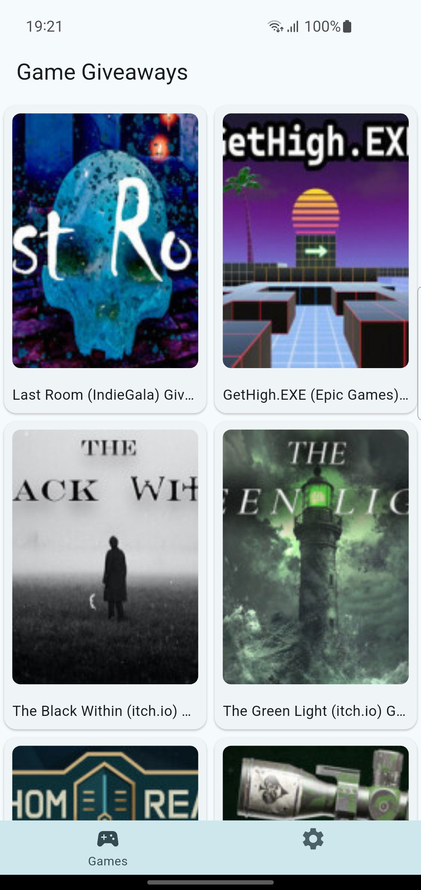
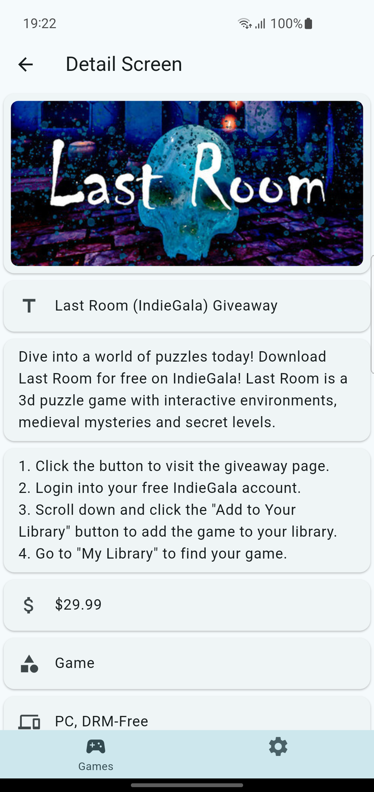
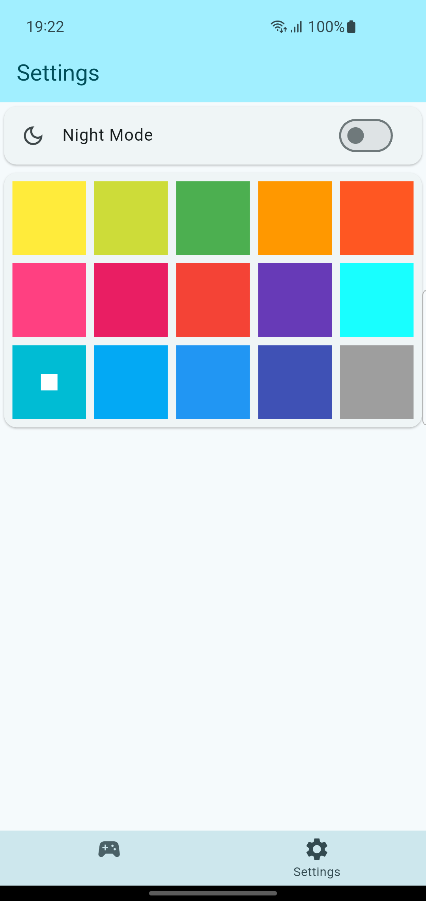
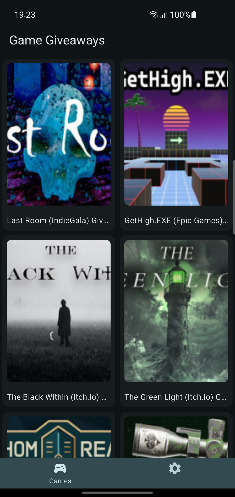

# Game Giveaways App

Flutter application that fetches and displays free game giveaways from the [GamerPower API](https://www.gamerpower.com/api/giveaways).

**Assignment: Read API: gamerpower.com**  
Student: Heng Ratana

## Screenshots

| Main Screen | Detail Screen | Settings Screen | Dark Mode |
| :---: | :---: | :---: | :---: |
|  |  |  |  |

## Features

- **Riverpod State Management**: Uses `AsyncNotifier`, `FutureProvider.family`, and `StateNotifier` (`lib/providers/`)
- **Bottom Navigation Bar**: Persistent tab navigation between Games and Settings (`lib/screens/main_screen.dart`)
- **Game Screen**: 2-column `GridView` with `CachedNetworkImage`, `Skeletonizer` loading state, pull-to-refresh, and scroll-to-top button (`lib/screens/game_screen.dart`)
- **Detail Screen**: Full giveaway details fetched by ID from the API (`lib/screens/detail_screen.dart`)
- **Settings Screen**: Dark mode toggle and 15 color themes persisted locally with `flutter_secure_storage` (`lib/screens/settings_screen.dart`)

## Project Structure

```
lib/
├── main.dart                  # ProviderScope + runApp
├── apps/my_app.dart           # MaterialApp, themes, routes
├── models/                    # ModelGiveAways (JSON <-> Dart)
├── services/                  # GiveawayService (HTTP calls)
├── providers/                 # Riverpod providers
└── screens/                   # main, game, detail, settings
```

## API Endpoints

- Giveaways List: `GET https://www.gamerpower.com/api/giveaways`
- Giveaway Detail: `GET https://www.gamerpower.com/api/giveaway?id={id}`

## Getting Started

```bash
flutter pub get
flutter run
```
